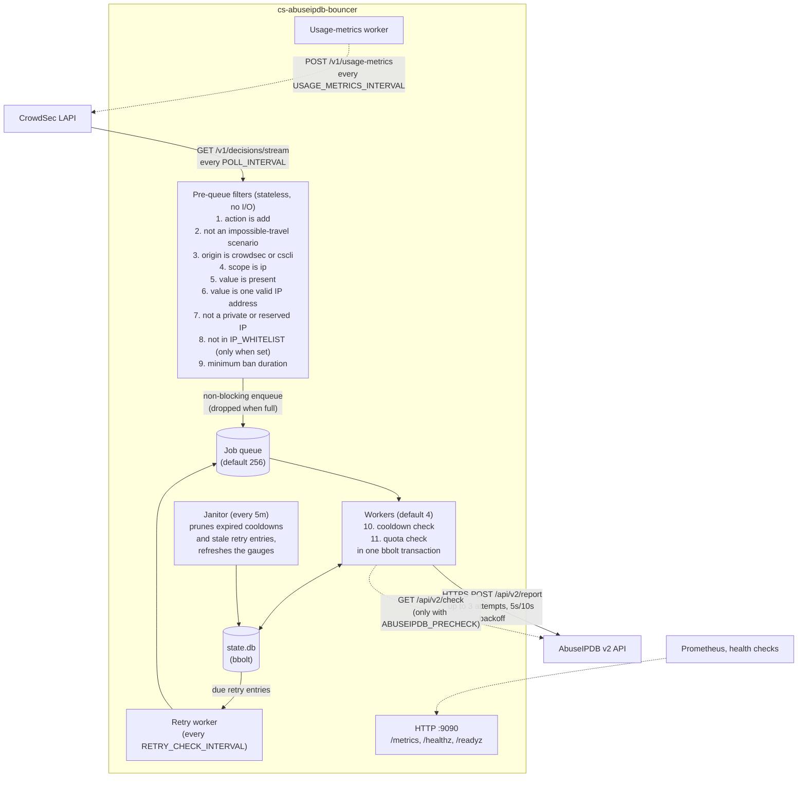

<p align="center">
  
</p>

# CrowdSec AbuseIPDB Bouncer
[](https://github.com/developingchet/cs-abuseipdb-bouncer/actions/workflows/release.yml)
[](https://github.com/developingchet/cs-abuseipdb-bouncer/actions/workflows/ci.yml)
[](https://scorecard.dev/viewer/?uri=github.com/developingchet/cs-abuseipdb-bouncer)
[](https://github.com/developingchet/cs-abuseipdb-bouncer)
[](https://hub.docker.com/r/developingchet/cs-abuseipdb-bouncer)
[](LICENSE)

A production-ready, security-hardened CrowdSec bouncer that automatically reports malicious IP addresses to AbuseIPDB in real-time.

## Overview

This bouncer connects directly to the CrowdSec Local API and reports new ban decisions to AbuseIPDB's threat intelligence database. It is implemented as a single static Go binary running in a distroless container with no shell, no root privileges, and a read-only filesystem.

**Key capabilities:**

- Real-time reporting via the CrowdSec LAPI decision stream
- Concurrent worker pool — multiple HTTP round-trips to AbuseIPDB run in parallel, so high-frequency ban waves no longer stall the event loop
- Intelligent scenario-to-category mapping (covers 22 of 23 AbuseIPDB categories; category 2 DNS Poisoning is not generated by current scenario patterns)
- Per-IP cooldown enforcement (15-minute default, matching AbuseIPDB's deduplication window)
- Daily quota tracking with UTC midnight reset and disk persistence
- Optional pre-check that skips AbuseIPDB-whitelisted IPs without spending report quota (the IP still enters its cooldown, so it is not checked again right away)
- Exponential backoff retry; failed reports (network errors, 5xx and other unexpected statuses, 401, 429 rate limits) are persisted and retried, honouring AbuseIPDB's `Retry-After` / `X-RateLimit-Reset` headers; duplicate-report 429s and invalid-parameter 422s are dropped, not retried
- Health endpoints (`/healthz`, `/readyz`) driven by the last successful LAPI pull and AbuseIPDB call — probes never touch `state.db` and never spend API quota
- State persists across container restarts via named Docker volume
- Structured JSON logging compatible with Loki, Splunk, and other SIEM tools
- Zero PII in reports -- only scenario names are transmitted

**Security properties:**

- Runs as UID 65532 (nonroot) inside a distroless container
- No shell, no package manager, no OS utilities in the runtime image
- `cap_drop: ALL` and `read_only: true` by default in docker-compose.yml
- Seccomp syscall allowlist (`security/seccomp-bouncer.json`) blocks all syscalls not required by the binary
- TLS 1.2+ enforced on all outbound connections
- API keys loaded from environment variables or `*_FILE` secrets; 80-character hex keys, Bearer tokens and `X-Api-Key` headers are automatically redacted from log output
- Docker image is signed with [Cosign](https://docs.sigstore.dev/cosign/overview/) (keyless OIDC) and accompanied by a CycloneDX SBOM on every release

## Compliance

This bouncer follows the CrowdSec Remediation Component Specification for Stream Mode, User-Agent identification, and LAPI Telemetry.

This repository is a reporter-only outbound sink:
- AppSec forwarding is intentionally omitted.
- CAPTCHA/remediation HTML is intentionally omitted.
- No inline traffic enforcement is implemented (no reverse proxy, firewall, or routing logic).

LAPI requests identify the component as `cs-abuseipdb-bouncer/<VERSION>`.

## How It Works



New decisions stream continuously from the LAPI. Each decision passes through eight stateless pre-queue filters (nine when `IP_WHITELIST` is set), then is handed off to a concurrent worker pool. Workers perform the quota and cooldown checks atomically (single bbolt transaction each) before dispatching to the AbuseIPDB sink. State is persisted to a named Docker volume so daily counts and per-IP cooldowns survive container restarts.

In parallel, a background usage-metrics worker aggregates successful AbuseIPDB submissions and pushes telemetry to `POST /v1/usage-metrics` every `30m` by default (`USAGE_METRICS_INTERVAL`, minimum `10m`).

## Quick Start

**Prerequisites:**
- Docker with Compose v2
- Running CrowdSec instance with accessible LAPI
- AbuseIPDB account (free tier: 1000 reports/day)

**Steps:**

```bash
# Register the bouncer with CrowdSec and save the printed key
docker exec crowdsec cscli bouncers add abuseipdb-bouncer

# Clone the repository
git clone https://github.com/developingchet/cs-abuseipdb-bouncer.git
cd cs-abuseipdb-bouncer

# Configure environment
cp .env.example .env
chmod 600 .env
nano .env  # Set CROWDSEC_LAPI_KEY and ABUSEIPDB_API_KEY

# Build and start
docker compose build
docker compose up -d

# Verify startup
docker logs -f abuseipdb-bouncer
docker exec crowdsec cscli bouncers list
```

> If the container exits immediately with `permission denied` on `/data/state.db`, see [Volume Permissions](docs/TROUBLESHOOTING.md#volume-permission-denied-at-startup) in the troubleshooting guide.

Expected startup log (JSON format):

```json
{"level":"info","limit":1000,"used_today":0,"cooldown":"15m0s","precheck":false,"min_duration":"0s","log_level":"info","workers":4,"message":"bouncer started"}
```

## Documentation

- **[Setup Guide](docs/SETUP.md)** - Complete installation procedures
- **[Configuration Reference](docs/CONFIGURATION.md)** - All environment variables explained
- **[Troubleshooting](docs/TROUBLESHOOTING.md)** - Common issues and solutions
- **[Design Rationale](docs/DESIGN.md)** - Architecture decisions and security analysis
- **[External References](docs/REFERENCES.md)** - Links to official documentation
- **[Compliance Checklist](COMPLIANCE.md)** - Technical mapping to CrowdSec remediation-component requirements

## Repository Structure

| Path | Contents |
|---|---|
| `cmd/bouncer/` | CLI entry point (Cobra) and the `healthcheck` subcommand used by the Docker `HEALTHCHECK` |
| `internal/bouncer/` | Main run loop and pre-queue filter pipeline, worker pool, janitor, `/healthz` and `/readyz` |
| `internal/config/` | Environment-based configuration and validation |
| `internal/decision/` | Filter pipeline and private/reserved IP detection |
| `internal/logger/` | Logging: the bridge for go-cs-bouncer's logrus output, and redaction of API keys and Bearer tokens |
| `internal/sink/` | Sink interface and typed errors (duplicate, rate limit, permanent, unauthorized) |
| `internal/sink/abuseipdb/` | AbuseIPDB HTTP client, category IDs and scenario-to-category mapping |
| `internal/metrics/` | Prometheus metric definitions |
| `internal/telemetry/` | LAPI `/usage-metrics` payload builder, processed counter and push worker |
| `internal/storage/` | bbolt persistence for the quota, cooldowns and retry queue, and an in-memory store for tests |
| `security/` | `seccomp-bouncer.json`, the OCI seccomp profile (minimal syscall allowlist) |
| `scripts/` | `validate-seccomp.sh`, a static check of the profile's required syscalls, and `test-coverage.sh`, the 100% coverage gate |
| `docs/` | Setup, configuration, design, troubleshooting and external references |
| `.github/` | Workflows (CI, release, image scan, Scorecard, Socket, Docker Hub description), pinned CI tools and Socket CLI requirements, Dependabot, CODEOWNERS |
| Repository root | `Dockerfile` (multi-stage, golang to distroless), `docker-compose.yml`, `.env.example`, `Makefile`, `.golangci.yml`, `socket.yml`, and the `COMPLIANCE`, `CONTRIBUTING`, `DOCKERHUB` and `SECURITY` documents |

## Configuration Summary

All configuration is via environment variables. Required:

```bash
CROWDSEC_LAPI_URL=http://crowdsec:8080   # URL of the CrowdSec LAPI
ABUSEIPDB_API_KEY=<from abuseipdb.com/account/api>

# LAPI auth mode A (API key)
CROWDSEC_LAPI_KEY=<from cscli bouncers add>

# LAPI auth mode B (mTLS)
# CROWDSEC_LAPI_TLS_CERT_PATH=/etc/crowdsec/client.crt
# CROWDSEC_LAPI_TLS_KEY_PATH=/etc/crowdsec/client.key
# CROWDSEC_LAPI_TLS_CA_CERT_PATH=/etc/crowdsec/ca.crt
```

Optional (all have defaults):

```bash
ABUSEIPDB_DAILY_LIMIT=1000    # Free=1000, Webmaster=3000, Premium=50000
ABUSEIPDB_PRECHECK=false      # Pre-check /check endpoint before reporting
ABUSEIPDB_MIN_DURATION=0      # Skip shorter decisions (seconds, or a duration such as 5m)
COOLDOWN_DURATION=15m         # Per-IP cooldown window
POLL_INTERVAL=10s             # LAPI polling frequency (min 2s; the bundled docker-compose.yml sets 30s)
LOG_LEVEL=info                # trace, debug, info, warn, error
LOG_FORMAT=json               # json or text
TLS_SKIP_VERIFY=false         # Skip TLS verification (self-signed certs)
DATA_DIR=/data                # Directory for state.db (mount a named volume here)
METRICS_ADDR=127.0.0.1:9090   # Address for /metrics, /healthz, /readyz (empty = disabled; the Docker image uses :9090)
USAGE_METRICS_ENABLED=true    # Enable periodic LAPI /usage-metrics push
USAGE_METRICS_INTERVAL=30m    # Telemetry push interval (min 10m)
CONFIG_FILE=                  # Optional path to YAML config file

# Concurrent worker pool (v2.0)
WORKER_COUNT=4                # Goroutines sending reports concurrently (1–64)
WORKER_BUFFER=256             # In-memory job queue size (1–10000)
JANITOR_INTERVAL=5m           # How often to prune state.db and update DB size metric (min 30s)
RETRY_CHECK_INTERVAL=30s      # How often to resend queued (failed / rate-limited) decisions (min 10s)
LAPI_TIMEOUT=10s              # HTTP timeout for LAPI requests (min 200ms)
```

See [CONFIGURATION.md](docs/CONFIGURATION.md) for complete details.

## Scenario Mapping

CrowdSec scenario names are mapped to AbuseIPDB categories via ordered substring matching. The author prefix is stripped and the name is lowercased before matching.

| Scenario Pattern | AbuseIPDB Categories | Description |
|------------------|---------------------|-------------|
| `*ssh*` | 22, 18 | SSH brute-force |
| `*sqli*`, `*sql-inj*` | 16, 21 | SQL injection |
| `*wordpress*`, `*drupal*` | 18, 21 | CMS attacks |
| `*http-dos*`, `*ddos*` | 4 | Denial of service |
| `*cve*`, `*log4*`, `*rce*` | 21, 20 | CVE exploitation |
| `*brute*`, `*-bf*`, `*rdp*` | 18 | Generic brute-force |
| (fallback) | 15 | Hacking |

Full 27-rule mapping table in [CONFIGURATION.md](docs/CONFIGURATION.md#scenario-category-mapping).

## Filtered Decisions

These decisions are intentionally never reported:

- **impossible-travel scenarios** - Account compromise heuristics, not IP-based abuse
- **Origins other than `crowdsec` and `cscli`** - CAPI and blocklist IPs that are already globally known, `cscli-import`, console decisions and any other origin
- **Private / reserved IP addresses** - RFC1918, loopback, link-local, CGNAT, benchmarking, multicast and the other reserved ranges listed in [Private IP Exclusion](docs/DESIGN.md#private-ip-exclusion) — IPv4-mapped IPv6 (`::ffff:10.0.0.1`) is checked as IPv4
- **Non-IP scopes** - Ranges, ASNs, country-level decisions (AbuseIPDB only accepts single IPs)
- **Malformed IP values** - Anything other than a bare address or a `/32` / `/128` prefix, including wider networks and zoned IPv6 addresses (skip reason `invalid_ip`)
- **Whitelisted IPs** - Addresses matching `IP_WHITELIST`, when it is set (skip reason `whitelist`)
- **Short decisions** - Bans shorter than `ABUSEIPDB_MIN_DURATION`, when it is set (skip reason `min_duration`)
- **AbuseIPDB-whitelisted IPs** - With `ABUSEIPDB_PRECHECK` on, addresses AbuseIPDB lists as whitelisted (skip reason `abuseipdb_whitelisted`)
- **IPs within the cooldown window** - Already reported within `COOLDOWN_DURATION` (default 15 minutes)
- **Decisions exceeding the daily quota** - Once the limit is reached, no further reports are sent that UTC day

## State Persistence

State is stored in a single `state.db` file (bbolt embedded database) inside `DATA_DIR` (default `/data`, mounted as a named Docker volume):

| Bucket | Key | Value |
|---|---|---|
| `quota` | `today` | JSON, for example `{"count":42,"date":"2026-02-17"}` |
| `cooldown` | The IP address; IPv6 colons become underscores (`2001:db8::1` is stored as `2001_db8__1`) | Cooldown expiry as a big-endian int64 Unix timestamp |
| `retry` | Same as `cooldown` | JSON, for example `{"ip":"203.0.113.42","scenario":"crowdsecurity/ssh-bf","retry_after":1739837130,"attempts":1}` |

Volume mount: `bouncer-state:/data`

The daily quota record resets automatically at UTC midnight. The background janitor (every 5 minutes by default, `JANITOR_INTERVAL`) prunes expired cooldown entries and retry entries that became due more than 24 hours ago. The retry bucket holds decisions waiting for another delivery attempt. All three survive container restarts via the named Docker volume.

## Observability

The HTTP server (enabled by default at `127.0.0.1:9090`; the Docker image listens on `:9090` inside the container) exposes three unauthenticated endpoints, so publish or bind it only to loopback or a private network (the bouncer logs a warning at startup when `METRICS_ADDR` is not a loopback address):

| Endpoint | Description |
|----------|-------------|
| `GET /metrics` | Prometheus metrics in text exposition format |
| `GET /healthz` | Liveness — HTTP 200 while the LAPI has been polled successfully within `max(5 × POLL_INTERVAL, 2m)` and fewer than 5 consecutive AbuseIPDB calls have failed; 503 otherwise. The same `max(5 × POLL_INTERVAL, 2m)` applies as a startup grace before the first pull. |
| `GET /readyz` | Readiness — as `/healthz`, and additionally 503 until the first successful LAPI pull |

Both health endpoints return a JSON body (`status`, `reason`, `last_lapi_pull`, `last_abuseipdb_ok`, `last_abuseipdb_failure`, `consecutive_abuseipdb_failures`) and are served from memory: they never open `state.db` and never call AbuseIPDB. The Docker `HEALTHCHECK` runs `bouncer healthcheck`, which GETs `/healthz` on `METRICS_ADDR` — so it requires `METRICS_ENABLED=true`.

Prometheus metrics:

| Metric | Type | Labels | Description |
|--------|------|--------|-------------|
| `cs_abuseipdb_decisions_processed_total` | Counter | — | All decisions received from the LAPI stream |
| `cs_abuseipdb_reports_sent_total` | Counter | — | Successful reports sent to AbuseIPDB |
| `cs_abuseipdb_decisions_skipped_total` | Counter | `filter` | Decisions dropped, by filter or outcome (`cooldown`, `quota`, `duplicate`, `rejected`, `retry_exhausted`, `buffer_full`, …) |
| `cs_abuseipdb_api_errors_total` | Counter | `type` | API errors: `rate_limit`, `auth`, `validation`, `network`, `timeout` |
| `cs_abuseipdb_quota_remaining` | Gauge | — | Remaining daily quota (resets at UTC midnight) |
| `cs_abuseipdb_bbolt_db_size_bytes` | Gauge | — | Size of `state.db` in bytes, updated by the janitor |
| `cs_abuseipdb_retry_queue_size` | Gauge | — | Decisions waiting in the persistent retry queue |
| `cs_abuseipdb_retry_queue_enqueued_total` | Counter | — | Decisions queued for retry (429 or transient failure) |
| `cs_abuseipdb_retry_attempts_total` | Counter | — | Retry attempts submitted from the queue |
| `cs_abuseipdb_last_lapi_pull_timestamp_seconds` | Gauge | — | Unix time of the last successful LAPI poll |
| `cs_abuseipdb_last_report_success_timestamp_seconds` | Gauge | — | Unix time of the last successful AbuseIPDB report |

```bash
curl http://localhost:9090/metrics | grep cs_abuseipdb
```

## Logging

JSON format (default):

```json
{"level":"info","ip":"203.0.113.42","sink":"abuseipdb","time":1739836530,"message":"reported"}
{"level":"debug","ip":"192.168.1.1","filter":"private_ip","detail":"ip=192.168.1.1 is private/reserved","time":1739836531,"message":"decision filtered (pre-queue)"}
```

Human-readable format (`LOG_FORMAT=text`):

```text
12:15PM INF reported ip=203.0.113.42 sink=abuseipdb
12:15PM DBG decision filtered (pre-queue) detail="ip=192.168.1.1 is private/reserved" filter=private_ip ip=192.168.1.1
```

Enable debug logging:

```bash
# In .env:
LOG_LEVEL=debug
docker compose up -d --force-recreate abuseipdb-bouncer
```

## Supply-Chain Verification

Every release is signed with [Cosign](https://docs.sigstore.dev/cosign/overview/) using keyless OIDC (no stored private key). Use Cosign 3 or later; Cosign 2 cannot read these signatures. Verify the image signature:

```bash
cosign verify developingchet/cs-abuseipdb-bouncer:latest \
  --certificate-identity-regexp="https://github.com/developingchet/cs-abuseipdb-bouncer/.github/workflows/release.yml@refs/tags/.*" \
  --certificate-oidc-issuer="https://token.actions.githubusercontent.com"
```

A CycloneDX SBOM is attached to every GitHub Release and embedded as a Cosign attestation on the Docker image.

The image is also published to GitHub Container Registry as `ghcr.io/developingchet/cs-abuseipdb-bouncer`, with the same tags and digest. It carries its own signature and SBOM attestation there, so the command above works with the `ghcr.io` name too.

## Building

The binary compiles to approximately 13MB. Docker is required (Go does not need to be installed locally):

```bash
docker compose build
```

To run tests directly (requires Go 1.27.4+; `-race` also needs a C compiler / CGO):

```bash
go test -race ./... -count=1 -timeout=120s
```

## Upgrade notes

### Upgrading to v2.5.0

**Metrics listener on loopback by default.** From v2.5.0, `METRICS_ADDR` defaults to `127.0.0.1:9090` instead of `:9090`. The Docker image sets `METRICS_ADDR=:9090`, so container deployments are unaffected. A native install (systemd, Windows) that is scraped by Prometheus from another host stops answering that scraper after upgrading to v2.5.0, and no warning is logged because the new default is a loopback address. Set `METRICS_ADDR` explicitly, for example `0.0.0.0:9090` or the private interface address the scraper uses, and keep the port behind a firewall since the endpoints are unauthenticated. The bouncer logs a warning at startup whenever `METRICS_ADDR` is not a loopback address.

**New `invalid_ip` skip reason.** A decision whose value is not a single IP address (malformed text, a network wider than `/32` or `/128`, or a zoned IPv6 address) is now dropped before the cooldown and quota checks and counted under `filter="invalid_ip"` in `cs_abuseipdb_decisions_skipped_total`. Earlier versions spent a cooldown entry and a quota unit on such values before AbuseIPDB refused them. Dashboards and alerts that enumerate `filter` label values should include the new one.

### Upgrading to v2.5.3

**`POLL_INTERVAL` now defaults to `10s`.** The built-in default changes from `2s` to `10s`, matching CrowdSec's recommended pull period and cutting default LAPI request traffic by 80%. The configurable minimum remains `2s`. Reporting latency follows the interval: a decision can now reach AbuseIPDB up to 10 s after CrowdSec issues it, instead of 2 s.

Deployments that never set `POLL_INTERVAL` and run the binary directly (systemd, Windows, bare Docker without the bundled compose file) move from 2-second to 10-second polling. The bundled `docker-compose.yml` is unaffected — it sets `POLL_INTERVAL=30s` when the variable is unset. To keep the previous behaviour, set `POLL_INTERVAL=2s` explicitly.

### Upgrading to v2.5.5

**Precheck skips are no longer counted as reports.** With `ABUSEIPDB_PRECHECK=true`, an IP that AbuseIPDB lists as whitelisted is now counted under `filter="abuseipdb_whitelisted"` in `cs_abuseipdb_decisions_skipped_total` and logged as `skipped: whitelisted by AbuseIPDB`. Earlier versions logged it as `reported`, incremented `cs_abuseipdb_reports_sent_total`, updated the last-success timestamp and included it in the usage metrics sent to the LAPI. The skip also returns the daily quota unit the worker charged when it admitted the decision; the IP keeps its cooldown. Dashboards that enumerate `filter` label values should include the new one.

**Usage metrics report the host OS.** The `os` block sent to `POST /v1/usage-metrics` now carries the os-release `ID` and `VERSION_ID` (for example `debian` and `12` in the image), as CrowdSec's own components do, instead of the Go OS name and CPU architecture.

Dashboards that assumed per-poll latencies (e.g. alerting on `cs_abuseipdb_last_lapi_pull_timestamp_seconds` staleness) are also unaffected: `/healthz` marks upstream stale after `max(5 × POLL_INTERVAL, 2m)`, which was already 2 minutes and does not change.

## Migration from v1.x

| Aspect | v1.x | v2.0 |
|--------|------|-------|
| State env var | `STATE_DIR` | `DATA_DIR` |
| Default path | `/tmp/cs-abuseipdb` | `/data` |
| Storage format | `daily` file + `cooldown/` directory | `state.db` (bbolt embedded database) |
| Volume mount | `bouncer-state:/tmp/cs-abuseipdb` | `bouncer-state:/data` |
| New in v2.0 | — | `METRICS_ENABLED`, `METRICS_ADDR`, `CONFIG_FILE`, `WORKER_COUNT`, `WORKER_BUFFER`, `JANITOR_INTERVAL`, `RETRY_CHECK_INTERVAL`, `USAGE_METRICS_ENABLED`, `USAGE_METRICS_INTERVAL`, `LAPI_TIMEOUT`, `IP_WHITELIST` |
| Supply-chain | — | Cosign keyless signing + CycloneDX SBOM |
| Runtime hardening | — | Seccomp syscall allowlist + log key redaction |

**No migration script is required.** On first start v2.0 creates a fresh `state.db`. The quota counter resets at UTC midnight anyway; cooldowns rebuild within one 15-minute window.

Update your compose file:
1. Change `STATE_DIR=/tmp/cs-abuseipdb` → `DATA_DIR=/data`
2. Change `- bouncer-state:/tmp/cs-abuseipdb` → `- bouncer-state:/data`
3. Optionally add `METRICS_ADDR=:9090` and expose port 9090

All new variables (`WORKER_COUNT`, `WORKER_BUFFER`, `JANITOR_INTERVAL`) have sensible defaults and require no changes to existing deployments.

## Contributing

Contributions are welcome. See [CONTRIBUTING.md](CONTRIBUTING.md) for guidelines.

Areas where help is needed:
- Additional scenario pattern mappings
- Integration guides (Kubernetes, Proxmox, Synology)

## License

MIT License. See [LICENSE](LICENSE) for full text.

## Support

- **Issues:** https://github.com/developingchet/cs-abuseipdb-bouncer/issues
- **Discussions:** https://github.com/developingchet/cs-abuseipdb-bouncer/discussions
- **CrowdSec Discord:** https://discord.gg/crowdsec

## Acknowledgments

Thanks to the CrowdSec team for the `go-cs-bouncer` library and to AbuseIPDB for maintaining the IP reputation database.
