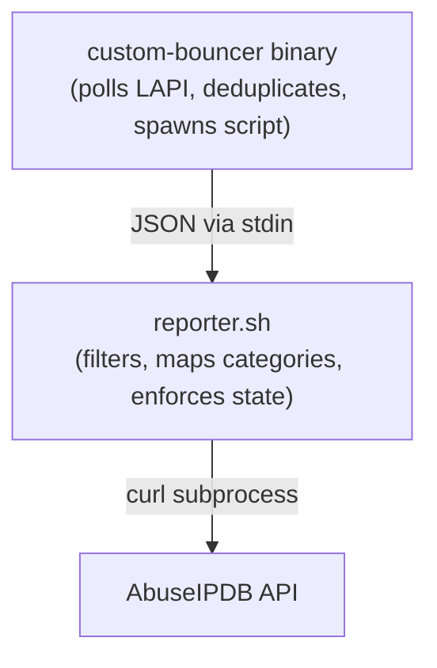
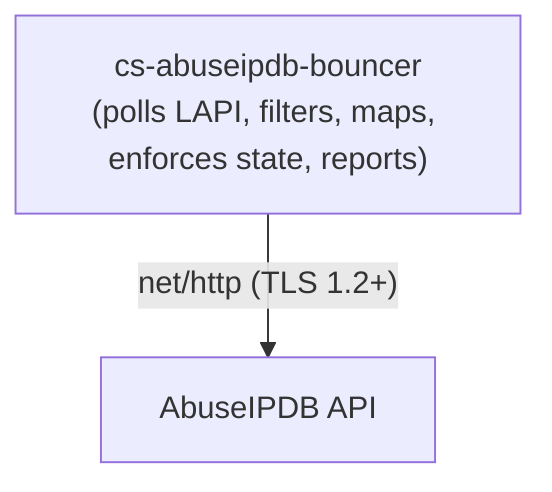
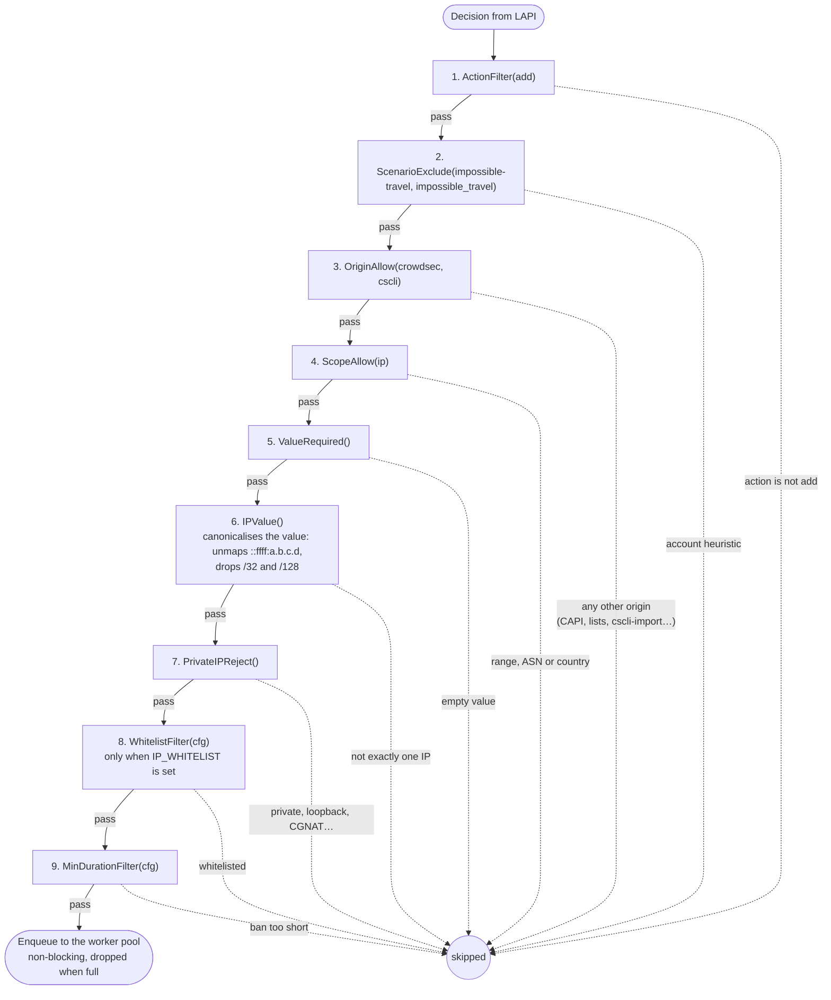
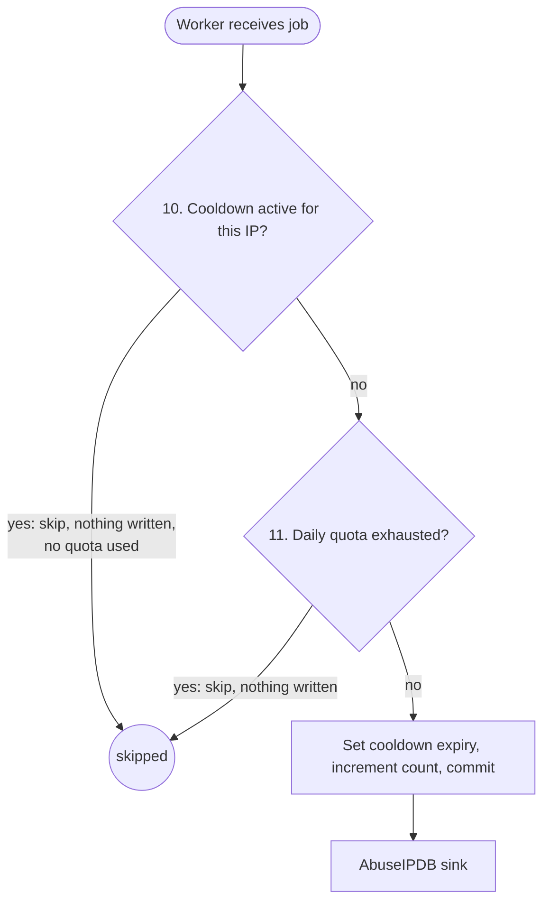
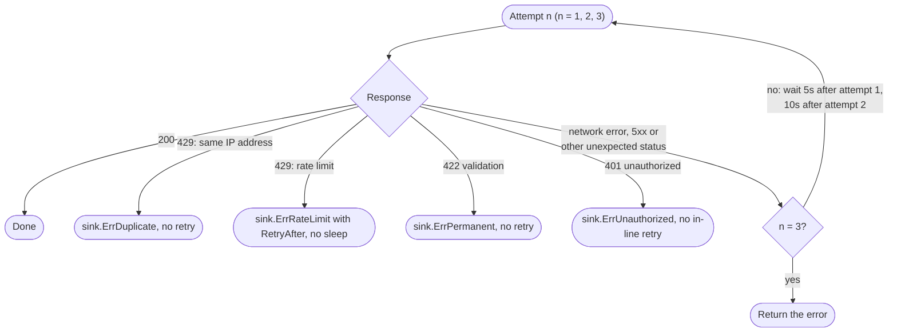

# Design Rationale

Architecture decisions and design philosophy for the CrowdSec AbuseIPDB Bouncer.

## Table of Contents

- [Language Choice](#language-choice)
- [Process Model](#process-model)
- [Security Architecture](#security-architecture)
- [Decision Filter Pipeline](#decision-filter-pipeline)
- [Concurrent Worker Pool](#concurrent-worker-pool)
- [Sink Interface](#sink-interface)
- [State Management](#state-management)
- [Retry Logic](#retry-logic)
- [Health Endpoints](#health-endpoints)
- [Supply-Chain Security](#supply-chain-security)
- [Testing Strategy](#testing-strategy)

---

## Language Choice

**Go** was chosen over Python and shell for the following reasons:

**Single static binary.** `CGO_ENABLED=0` produces a fully static binary with no dynamic library dependencies. This enables the use of a distroless base image with no shell, no package manager, and no OS utilities -- reducing the attack surface to essentially zero beyond the binary itself and the CA certificate bundle.

**Type safety.** The filter pipeline, scenario mapper, and state management all benefit from compile-time type checking. The original shell implementation parsed untyped JSON strings at runtime; the Go implementation uses typed structs from the first byte read off the wire.

**Testability.** Every component is covered by unit tests. The shell implementation had no automated tests and could only be verified end-to-end against a live CrowdSec instance.

**Native LAPI integration.** CrowdSec maintains an official Go bouncer library (`go-cs-bouncer`) that handles authentication, long-polling, decision streaming, and reconnection. Using it eliminates the indirection of the previous architecture (custom-bouncer binary → stdin pipe → shell script → curl).

**Binary size.** The compiled binary is approximately 13MB. With the distroless base, the total image is about 26MB uncompressed -- comparable to the previous Alpine-based image but with a dramatically smaller attack surface.

---

## Process Model

The previous implementation used three layers:



The current implementation uses one:



Removing two layers eliminates:
- Subprocess spawning overhead (each curl call was a new process)
- JSON parsing via jq (a runtime dependency)
- Stdin buffering and partial-read edge cases
- Script restart logic managed by the bouncer binary
- Config template rendering via sed in the entrypoint script

---

## Security Architecture

### Distroless Base Image

The runtime image is `gcr.io/distroless/static-debian12:nonroot`. It contains:
- The Go binary
- CA certificates (for outbound TLS)
- Timezone data (for UTC midnight quota resets)
- Nothing else

There is no shell (`/bin/sh`), no package manager, no coreutils, no `curl`, no `wget`. An attacker who achieves code execution inside the container has no tools to work with.

### Least Privilege

```yaml
# docker-compose.yml
read_only: true          # Root filesystem is read-only
cap_drop: [ALL]          # No Linux capabilities
security_opt:
  - no-new-privileges    # Cannot gain privileges via setuid
  - "seccomp:./security/seccomp-bouncer.json"
```

The container runs as UID 65532 (the distroless nonroot user). It writes only to `/data` (named volume, bbolt database) and `/tmp` (tmpfs mount for the Go runtime).

### Seccomp Profile

`security/seccomp-bouncer.json` is a minimal OCI seccomp profile with `defaultAction: SCMP_ACT_ERRNO`. It permits only the syscalls the bouncer and the container runtime actually use. The list below is a selection, grouped by function; the profile file is the complete list:

- **File I/O:** `read`, `write`, `open`, `openat`, `close`, `stat`, `fstat`, `lstat`, `fstatfs`, `lseek`, `fsync`, `fdatasync`, `ftruncate`, `rename`, `unlink`, `mkdir`, `access`, `faccessat`, `newfstatat`, `getcwd`, `openat2`
- **Memory:** `mmap`, `mprotect`, `munmap`, `mremap`, `madvise`, `brk`
- **Network (TCP):** `socket`, `connect`, `bind`, `listen`, `accept`, `accept4`, `getsockname`, `getpeername`, `setsockopt`, `getsockopt`, `sendto`, `recvfrom`, `sendmsg`, `recvmsg`, `shutdown`
- **I/O multiplexing:** `poll`, `epoll_create1`, `epoll_ctl`, `epoll_pwait`, `select`, `pselect6`, `pipe2`, `eventfd2`
- **Threading/sync:** `clone3`, `futex`, `set_robust_list`, `get_robust_list`, `sched_yield`, `tgkill`, `rt_sigaction`, `rt_sigprocmask`, `rt_sigreturn`, `sigaltstack`
- **Clock/time:** `clock_gettime`, `clock_getres`, `nanosleep`, `clock_nanosleep`, `gettimeofday`
- **Process:** `exit_group`, `getpid`, `gettid`, `dup2`, `dup3`, `getrandom`, `arch_prctl`

### Secret Handling

API keys are loaded from environment variables, from files named by `CROWDSEC_LAPI_KEY_FILE` / `ABUSEIPDB_API_KEY_FILE` (Docker / Kubernetes secrets), or from the optional `CONFIG_FILE`. The bouncer never writes them to disk, and they are not baked into the image. A `RedactWriter` (`internal/logger/redact.go`) wraps stderr and applies three regular expressions before any log line reaches the output:

1. `[A-Fa-f0-9]{80,}` → `[REDACTED-API-KEY]` — matches the 80-character hex format used by AbuseIPDB API keys. The whole hex run is replaced, so a key that directly follows or precedes other hex characters (a request ID, a digest) is never partially logged
2. `(?i)bearer\s+[A-Za-z0-9\-._~+/]+=*` → `bearer [REDACTED]` — matches Bearer tokens in any case
3. `(?i)x-api-key:\s*[^\s"\\]+` → `X-Api-Key: [REDACTED]` — matches the CrowdSec LAPI bouncer key in dumped request headers

The writer always returns `len(p)` (the original byte count) to satisfy zerolog's internal accounting even when the redacted output is shorter.

### TLS Policy

All outbound connections enforce TLS 1.2 as the minimum version:

```go
transport := &http.Transport{
    TLSClientConfig: &tls.Config{
        MinVersion: tls.VersionTLS12,
    },
}
```

This is set unconditionally in the AbuseIPDB client. For LAPI connections, the `go-cs-bouncer` library uses the standard Go TLS defaults, which also enforce TLS 1.2+ on Go 1.18 and later.

---

## Decision Filter Pipeline

Decisions pass through two ordered pipelines:

### Pre-Queue Pipeline (main event loop — stateless, no I/O)

Eight filters (nine when `IP_WHITELIST` is set) run synchronously in the event loop before a decision is enqueued for the worker pool. Because these filters perform no I/O, they cannot block the loop.



Deleted decisions in the stream are logged at debug level and never enter this pipeline, so the `action` filter is a defensive check.

### Worker-Side Checks (atomic bbolt transactions)

Each worker dequeues a job and runs one atomic store operation, `Admit(ip)`, before calling any sink. Both checks share a single `bolt.Update`:



The order (cooldown before quota) is intentional: a cooldown hit does not consume a quota unit. Writing only after both checks pass means that once the daily quota is exhausted, new IPs add no cooldown entries, so a flood of unique decisions cannot grow `state.db`.

### Why Two Pipelines?

The original single synchronous pipeline (all 9 filters in the event loop) blocked the event loop for the duration of every AbuseIPDB HTTP round-trip (up to ~15 s with retries during rate-limiting). During a high-frequency ban wave, decisions could back up in the LAPI stream while the bouncer waited for one HTTP call to complete.

The two-pipeline design separates the fast stateless checks (nanoseconds, run in the loop) from the slow I/O-bound operations (milliseconds to seconds, run in parallel workers). The quota and cooldown checks were moved to the worker side because they require write access to the bbolt database -- a serialisation point anyway -- and are tightly coupled to the decision whether to actually call AbuseIPDB.

Each filter is a typed function: `func(d *Decision) *SkipReason`. Returning `nil` passes; returning a `*SkipReason` rejects with a named reason for logging and metrics.

### Impossible-Travel Exclusion

Impossible-travel scenarios detect account compromise by correlating authentication events from geographically distant locations. The source IP in these decisions is the legitimate user's current location -- not an attacker. Reporting it to AbuseIPDB would flag innocent IPs.

### CAPI/Lists Exclusion

Community blocklist (CAPI) IPs are already globally aggregated by CrowdSec. Re-reporting them to AbuseIPDB is redundant and wastes daily quota. Only locally-detected decisions (`crowdsec` origin from scenario matching) and manual decisions (`cscli` origin) are eligible.

### Private IP Exclusion

Private and reserved IP ranges are rejected by `internal/decision/ip.go` using `net/netip`, which is exact and immune to regex edge cases:

| Range | Purpose |
|---|---|
| `10.0.0.0/8` | RFC 1918 private |
| `172.16.0.0/12` | RFC 1918 private |
| `192.168.0.0/16` | RFC 1918 private |
| `127.0.0.0/8` | Loopback (RFC 5735) |
| `169.254.0.0/16` | Link-local (RFC 3927) |
| `0.0.0.0/8` | This network (RFC 1122) |
| `100.64.0.0/10` | CGNAT (RFC 6598) |
| `192.0.0.0/24` | IETF protocol assignments (RFC 6890) |
| `198.18.0.0/15` | Benchmarking (RFC 2544) |
| `224.0.0.0/4` | Multicast |
| `240.0.0.0/4` | Reserved, including the 255.255.255.255 broadcast address |
| `::/128` | IPv6 unspecified |
| `::1/128` | IPv6 loopback (RFC 4291) |
| `fe80::/10` | IPv6 link-local (RFC 4291) |
| `fc00::/7` | IPv6 unique local (RFC 4193) |
| `ff00::/8` | IPv6 multicast |

IPv4-mapped IPv6 addresses (`::ffff:10.0.0.1`) are unmapped before the check. The RFC 5737 / RFC 3849 documentation ranges are intentionally not listed: they never occur in real traffic and the test suite uses them as stand-ins for public IPs.

---

## Concurrent Worker Pool

### Design

`internal/bouncer/pool.go` implements a fixed-size goroutine pool backed by a buffered channel:

```go
type workerPool struct {
    jobCh   chan workerJob     // bounded channel (WORKER_BUFFER capacity)
    wg      sync.WaitGroup     // tracks live workers
    store   storage.Store
    sinks   []sink.Sink
    counter *telemetry.Counter // usage-metrics counter (nil when USAGE_METRICS_ENABLED=false)
    health  *healthState       // liveness signals for /healthz and /readyz
}
```

**Submission** is non-blocking. If the channel is full, the job is dropped and `DecisionsSkipped.WithLabelValues("buffer_full")` is incremented. This prevents the event loop from ever blocking on the pool, at the cost of dropping decisions during traffic spikes. The buffer size (`WORKER_BUFFER`, default 256) should be set to match the expected burst depth.

**Startup ordering:** the pool is created before the retry worker starts, because the retry worker flushes due entries immediately (the crash-recovery case) and submits them to the pool.

**Shutdown** is ordered: `Run` cancels its context, waits for the retry worker (the only other goroutine that calls `submit`) to exit, and only then calls `pool.stop()`, which closes `jobCh` and waits for workers to drain. Closing the channel while a producer could still send would panic. Reports interrupted by the cancelled context are persisted to the retry queue rather than lost.

**Outcome handling** (per report, in `workerPool.reportTo`):

| Sink result | Health | Action |
|-------------|--------|--------|
| success | OK | count as sent |
| `sink.ErrDuplicate` (429 "same IP … once in 15 minutes") | OK | drop, `duplicate` skip metric |
| `sink.ErrWhitelisted` (precheck: whitelisted by AbuseIPDB) | OK | drop, `abuseipdb_whitelisted` skip metric |
| `sink.ErrRateLimit` (other 429) | OK | queue for retry after `RetryAfter` |
| `sink.ErrPermanent` (422 validation) | OK | drop, `rejected` skip metric |
| context cancelled (shutdown) | — | queue for retry in 10 s |
| anything else (network errors, 5xx and other unexpected statuses, `sink.ErrUnauthorized`) | failure | queue with 1 m → 30 m exponential backoff |

A decision is attempted at most 6 times (`maxDeliveryAttempts`); the attempt count is persisted with the retry entry so the cap holds across restarts.

### Known Limit: bbolt Write Serialisation

bbolt serialises all write transactions — only one `db.Update` runs at a time. Under very high concurrency this means `Admit` calls from different workers queue behind each other. In practice, the AbuseIPDB HTTP round-trip (100 ms–15 s) dominates worker latency by orders of magnitude, so bbolt is never the bottleneck at realistic worker counts (default 4, max 64).

If bbolt serialisation does become a bottleneck at very high scale, the recommended path is to replace `BoltStore` with a Redis-backed implementation of the `Store` interface — the interface boundary (`Admit`) is already designed for atomic operations.

### Response Buffer Pooling

`internal/sink/abuseipdb/client.go` uses a `sync.Pool` of `*bytes.Buffer` to reuse response body read buffers across concurrent requests:

```go
var respBufPool = sync.Pool{
    New: func() any { return bytes.NewBuffer(make([]byte, 0, 4096)) },
}
```

Each use copies the buffer contents to a fresh `[]byte` before returning the buffer to the pool. This prevents use-after-pool-put bugs while still avoiding per-request heap allocations for the common case where responses fit within 4096 bytes.

---

## Sink Interface

```go
type Sink interface {
    Name() string
    Report(ctx context.Context, r *Report) error
    Close() error
}
```

There is deliberately no active health probe on the interface: for AbuseIPDB any probe would spend `/check` quota. Sink health is instead inferred from real report outcomes (see [Health Endpoints](#health-endpoints)).

AbuseIPDB is the first and only implementation. The interface exists to support future reporters (Slack alerts, webhook POST, MISP feed, custom SIEM) without modifying the bouncer's event loop.

Sinks own their own category mapping. The `Report` struct carries only `IP`, `DecisionID`, `Scenario`, and `Duration` -- the AbuseIPDB sink translates `Scenario` to category IDs internally. A hypothetical Slack sink would format a different message from the same input.

---

## State Management

State is stored in a single `state.db` file using [bbolt](https://github.com/etcd-io/bbolt), an embedded ACID key-value store. The database contains three buckets.

### Daily Quota Counter (`quota` bucket)

**Key:** `today` (constant)
**Value:** JSON-encoded struct

```json
{"count": 42, "date": "2026-02-17"}
```

The date is checked inside every `Admit` transaction. If the stored date differs from the current UTC date, the counter is reset to zero before the check proceeds. The entire read-check-increment sequence runs in a single `bolt.Update` (serialised write transaction), making the operation atomic and race-free even with multiple concurrent workers.

### Per-IP Cooldown (`cooldown` bucket)

**Key:** sanitised IP string (e.g. `203.0.113.42` for IPv4, `2001_db8__1` for IPv6 — any CIDR suffix stripped and colons replaced with underscores; dots are kept)
**Value:** big-endian int64 Unix timestamp of expiry (8 bytes)

`Admit(ip)` runs in a single `bolt.Update`:
1. Read the stored expiry for `ip`
2. If the current time is before expiry, return `AdmitCooldown` — cooldown active, do not report
3. Read today's quota record; if it is at the limit, return `AdmitQuotaExhausted` without writing anything
4. Otherwise, increment the quota count, write the new expiry (`now + cooldownDuration`) and return `AdmitGranted`

This atomic check-and-set eliminates the TOCTOU race present in the earlier separate `CooldownAllow()` + `CooldownRecord()` design, where two concurrent workers could both observe "no cooldown" and both proceed to report the same IP.

### Retry Queue (`retry` bucket)

**Key:** sanitised IP string, as in the `cooldown` bucket
**Value:** JSON-encoded struct

```json
{"ip": "203.0.113.42", "scenario": "crowdsecurity/ssh-bf", "retry_after": 1739837130, "attempts": 1}
```

`ip` keeps the original value for the AbuseIPDB call, `retry_after` is the Unix time the entry becomes due, and `attempts` counts the delivery attempts already made. Enqueuing an IP that is already queued replaces its entry. The retry worker dequeues due entries every `RETRY_CHECK_INTERVAL` (and once at startup) and resubmits them to the worker pool.

### Cooldown Pruning (Janitor)

`internal/bouncer/janitor.go` runs a background goroutine on a configurable tick (`JANITOR_INTERVAL`, default 5 minutes):

1. **Prune:** `store.CooldownPrune()` deletes all cooldown entries whose expiry timestamp is in the past. This bounds the growth of `state.db` to the number of unique IPs seen within the cooldown window. `store.RetryPrune()` removes retry entries that became due more than 24 hours ago.
2. **DB size metric:** `os.Stat(store.DBPath()).Size()` is written to the `cs_abuseipdb_bbolt_db_size_bytes` Prometheus gauge. This metric is useful for detecting unexpected growth (e.g. a misconfigured cooldown of 0 seconds generating millions of entries).
3. **Queue and quota gauges:** `cs_abuseipdb_retry_queue_size` and `cs_abuseipdb_quota_remaining` are refreshed from the store.

The janitor exits cleanly when its context is cancelled (the same context as the bouncer's `Run` loop).

### Why bbolt?

- **No external dependencies** — the database is embedded in the binary; no Redis, no PostgreSQL, no external process to manage
- **ACID guarantees** — crash-consistent; a power failure mid-write does not corrupt the database
- **Single file** — trivial to back up, inspect, or copy (`cp state.db state.db.bak`)
- **Sufficient performance** — bbolt serialises write transactions, but the AbuseIPDB HTTP call dominates latency by orders of magnitude; bbolt is never the bottleneck

---

## Retry Logic

The AbuseIPDB client uses a custom retry strategy rather than a generic retry library. The semantics are too specific for a general-purpose implementation:



Key decisions (checked against https://docs.abuseipdb.com/):
- AbuseIPDB rejects a repeat report of the same IP within 15 minutes with **429**, not 422. It is recognised by its message and dropped: resending cannot succeed.
- 422 is AbuseIPDB's validation error (bad IP, bad categories). It is a real failure and is logged at error level, not counted as a sent report.
- For other 429s the wait comes from the `Retry-After` header (seconds), falling back to `X-RateLimit-Reset` (epoch of the daily reset), then an "in N seconds" hint in the body, then 60 s; capped at 24 h. The client never sleeps on 429 — the worker pool persists the decision to the retry queue.
- 401 is not retried in-line, but the pool queues the decision with backoff: once the key is fixed and the container restarted, queued reports are delivered. The sixth attempt is the last (about half an hour of backoff), so a key fixed later loses those decisions.
- Network errors, 5xx responses and any other unexpected status retry in-line with a doubling backoff (5 s, 10 s); if all three attempts fail, the pool queues the decision.

---

## Health Endpoints

`internal/bouncer/health.go` keeps lock-free (atomic) timestamps updated by the running process:

- `recordLAPIPull` — every message received on the go-cs-bouncer stream channel (one per successful poll)
- `recordSinkOK` / `recordSinkFailure` — every AbuseIPDB outcome, classified as in the pool table above

`/healthz` (liveness) fails when the last pull is older than `max(5 × POLL_INTERVAL, 2m)` (with the same grace after startup) or after 5 consecutive AbuseIPDB failures. `/readyz` additionally requires one successful pull. Both are served from memory and return JSON.

The Docker `HEALTHCHECK` runs `bouncer healthcheck`, a tiny HTTP client that GETs `/healthz` on the loopback form of `METRICS_ADDR`. It must never construct the `Bouncer`: that opens `state.db`, and bbolt holds an exclusive `flock` on it for the lifetime of the running process, so a second opener — even read-only — blocks until its 2 s timeout. (Earlier versions did exactly that and reported `storage: open /data/state.db: timeout` on every probe.)

go-cs-bouncer runs with `RetryInitialConnect: true`, so an unreachable LAPI at startup keeps the process alive and retrying (every 10 s) rather than exiting; the health endpoint turns unhealthy once the grace period passes. Its logrus output — the only place LAPI poll failures are reported — is bridged into zerolog (`internal/logger/logrus.go`), capped at `info` because the CrowdSec client dumps request headers (including `X-Api-Key`) at debug/trace.

---

## Supply-Chain Security

### Cosign (Keyless OIDC Signing)

Every release tag triggers a GitHub Actions workflow that signs the published Docker image using [Cosign](https://docs.sigstore.dev/cosign/overview/) in keyless mode. The signature is issued against the GitHub Actions OIDC token — no private key is stored anywhere.

```yaml
permissions:
  id-token: write  # required for OIDC token issuance
```

Verification needs Cosign 3 or later, whose signature format Cosign 2 cannot read:

```bash
cosign verify developingchet/cs-abuseipdb-bouncer:<tag> \
  --certificate-identity-regexp="https://github.com/developingchet/cs-abuseipdb-bouncer/.github/workflows/release.yml@refs/tags/.*" \
  --certificate-oidc-issuer="https://token.actions.githubusercontent.com"
```

### CycloneDX SBOM

The `anchore/sbom-action` step generates a CycloneDX JSON SBOM from the published image after it is pushed. One build pushes the image to Docker Hub and to GitHub Container Registry, so both registries serve the same digest. The SBOM is:

1. Attached to the GitHub Release as `cs-abuseipdb-bouncer.sbom.cyclonedx.json`
2. Embedded as a Cosign attestation on the image in each registry (`cosign attest --type cyclonedx`), next to the image's Cosign signature

The SBOM lists every package present in the image, enabling downstream consumers to check for known CVEs in the exact packages shipped.

### Trivy Scan

Every release pipeline runs `aquasecurity/trivy-action` against the linux/amd64 build of the image before pushing it to either registry; the weekly image scan covers both published architectures. The step fails (and blocks publication) if any HIGH or CRITICAL CVEs are found in packages with available fixes.

---

## Testing Strategy

All packages have `_test.go` files with table-driven tests. External dependencies are mocked:

- **AbuseIPDB API:** `httptest.NewServer` in `client_test.go` -- no real API calls in tests
- **CrowdSec LAPI:** `bouncer_test.go` calls `processDecision` directly with typed arguments. `runtime_test.go` builds a real `StreamBouncer` and runs `Run` against an `httptest.NewServer` fake LAPI
- **Filesystem:** `t.TempDir()` provides isolated, automatically-cleaned directories for bbolt tests

### Concurrency Tests

`internal/storage/bbolt_concurrent_test.go` verifies the atomic store operations under real concurrent load:

| Test | Scenario | Invariant |
|------|----------|-----------|
| `TestQuotaConsume_Concurrent` | 50 goroutines, limit=10 | Exactly 10 succeed |
| `TestCooldownConsume_SameIP` | 20 goroutines, 1 IP | Exactly 1 succeeds |
| `TestCooldownConsume_DifferentIPs` | 20 goroutines, 20 IPs | All 20 succeed |
| `TestAdmit_ConcurrentUniqueIPs` | 50 goroutines, 50 IPs, limit=10 | Exactly 10 admitted, 10 cooldown entries |
| `TestAdmit_ConcurrentSameIP` | 20 goroutines, 1 IP | Exactly 1 admitted, 1 quota unit used |

All tests are run with `-race` in CI.

### Worker Pool Tests

`internal/bouncer/pool_test.go` covers the end-to-end pool behaviour using an in-memory store and stub sinks:

| Test | What it validates |
|------|-------------------|
| `TestWorkerPool_10kDecisions` | 10k decisions, 8 workers — no panic, deadlock, or race |
| `TestWorkerPool_QuotaNotExceeded` | 100 decisions, limit=10 — sink receives ≤ 10 reports |
| `TestWorkerPool_CooldownAtomicity` | 200 decisions for 1 IP — sink receives exactly 1 report |
| `TestWorkerPool_CooldownHitConsumesNoQuota` | 100 decisions for 1 IP — exactly 1 quota unit used |
| `TestWorkerPool_ExhaustedQuotaSetsNoCooldown` | 200 unique IPs after the quota is used up — no reports, no cooldown entries |
| `TestWorkerPool_Backpressure` | Buffer=10, flood 3× — drops observed, no deadlock |
| `TestWorkerPool_GracefulShutdown` | Cancel mid-flight — `stop()` returns within 5s |

```bash
# Run all tests with race detector
go test -race ./... -count=1 -timeout=120s

# Targeted concurrency tests
go test -race -count=5 ./internal/storage/... -run TestCooldownConsume_SameIP
go test -race -count=5 ./internal/bouncer/... -run TestWorkerPool_CooldownAtomicity

# Coverage
go test -coverprofile=coverage.out ./...
go tool cover -html=coverage.out
```
